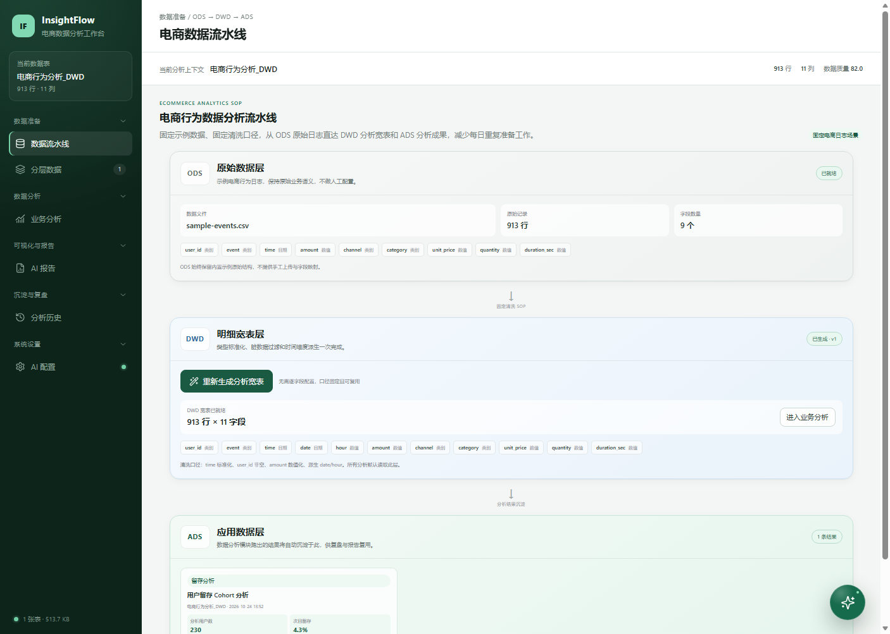
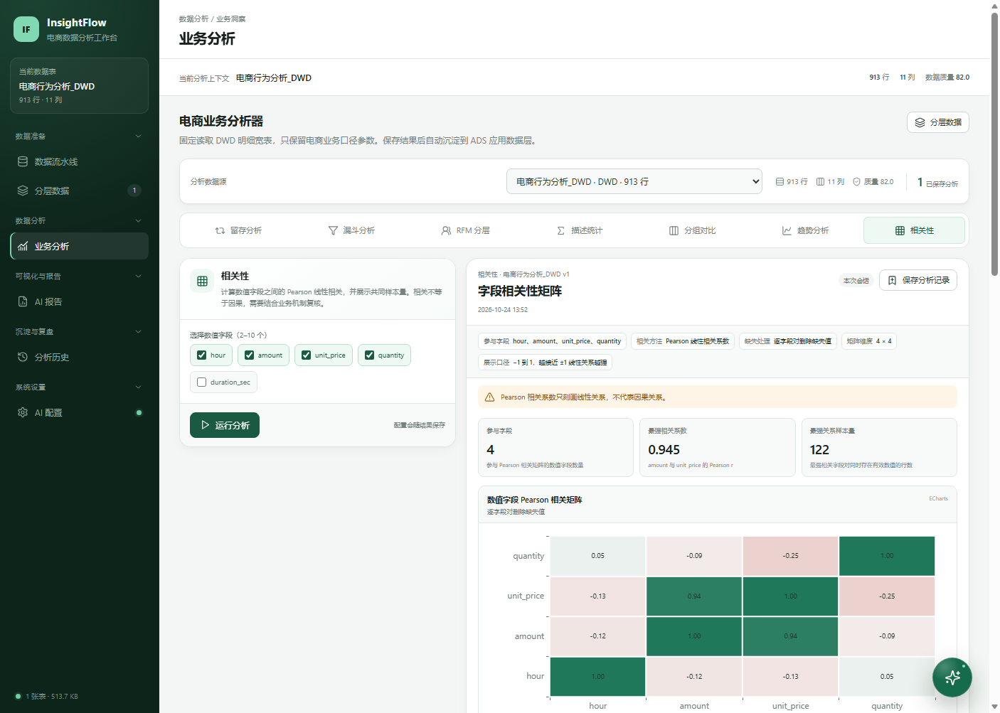
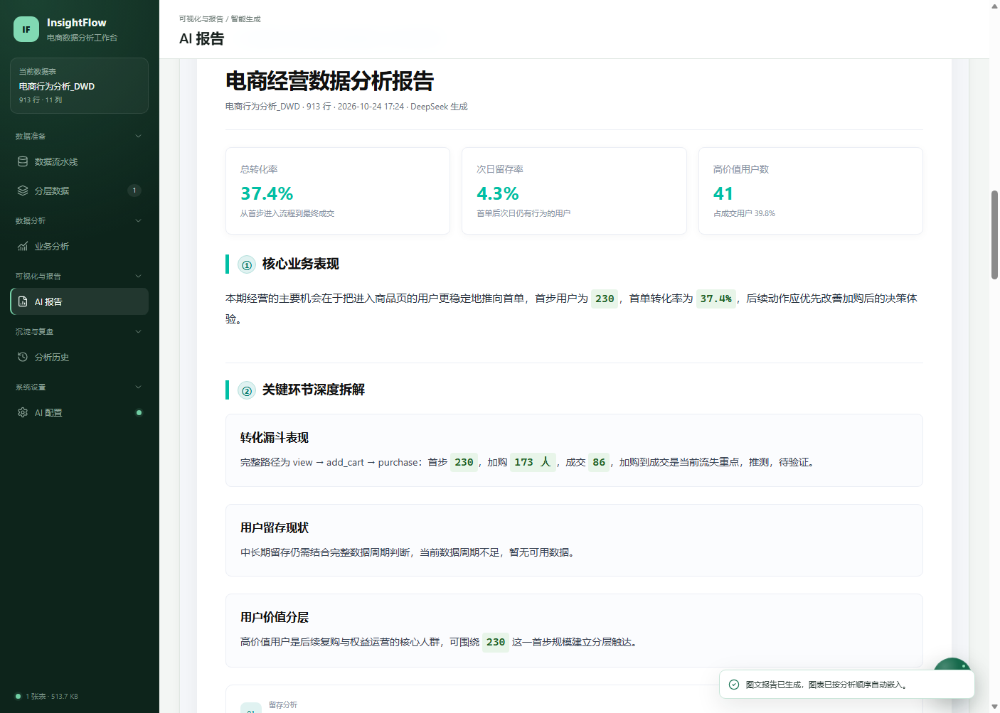
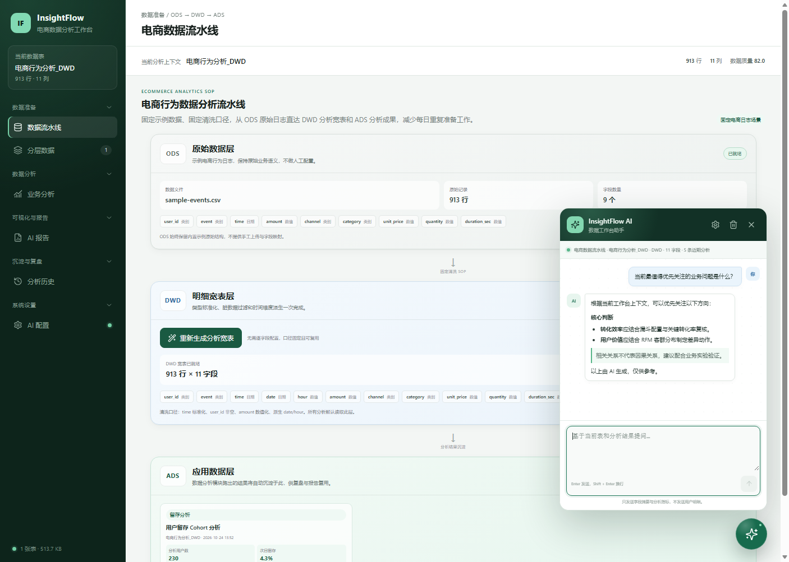
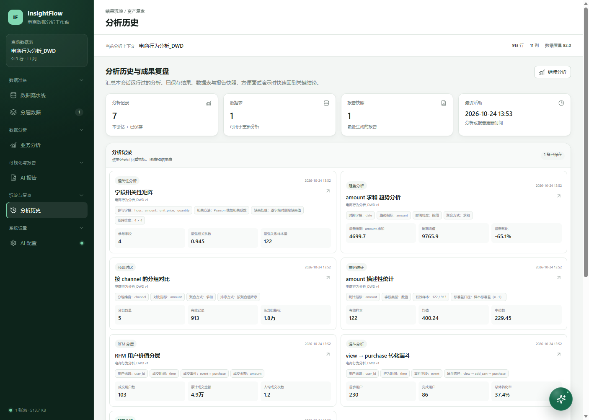

# InsightFlow · 电商数据分析工作台

一个面向**电商数据分析 / 运营岗位面试展示**的单页 AI 数据分析工作台。

项目不是通用 BI、Excel 替代品或“大而全”的数据平台。它只聚焦一个高频、重复、可标准化的场景：**电商行为日志的清洗、分析、复盘和报告交付**。目标是用更窄的边界展示完整的数据产品思维、业务分析能力和工程落地能力。

> **数据声明：** 本项目中的用户、订单、商品、金额、渠道和行为日志全部是模拟数据，仅用于作品集演示。项目不包含任何真实用户数据，也不声称可未经改造直接用于生产环境。

---

## 为什么做这个项目

这个作品集想证明的不是“一个人能独立做完整个 BI 平台”，而是：

1. 能识别一类具体的、重复劳动密集型工作；
2. 能把非标准业务流程整理成 ODS → DWD → ADS 的固定 SOP；
3. 能把分析口径、可视化和 AI 输出连成可复用的工作流；
4. 能在 AI 产品中主动设置边界、校验与人工复核环节；
5. 能把工具做成面试官可以在几分钟内理解和验证的产品。

因此，本项目刻意采用“**专才工具**”定位：固定的电商日志结构、固定的清洗规则、固定的分析菜单和固定的报告 SOP。牺牲通用性，换取场景贴合度、演示速度和业务可解释性。

## 核心能力

- **ODS 原始层**：首次打开自动加载约 900 行、覆盖 30 天的模拟电商行为日志。
- **DWD 明细层**：一键完成时间标准化、脏用户过滤、金额类型转换及日期/小时维度派生。
- **ADS 应用层**：保存分析结果，在分析历史和报告中复用。
- **7 类业务分析**：
  - 留存分析
  - 漏斗分析
  - RFM 用户分层
  - 描述性统计
  - 分组对比
  - 趋势分析
  - 相关性分析
- **自动图表看板**：按分析执行顺序自动渲染，不需要用户手动选 X/Y 轴。
- **一键图文报告**：AI 只生成业务文字，图表由前端通过 ECharts 截图后按分析顺序嵌入。
- **报告范围控制**：分析卡上的 × 只影响本次报告，不删除分析历史或 ADS 记录。
- **全局 AI 助手**：携带当前数据表、数据层级、分析结果和当前模块上下文。
- **口径透明**：每类分析可查看等价 SQL，并支持人工修改口径；AI 建议不会自动覆盖或执行 SQL。

## 页面预览

### ODS → DWD → ADS 数据流水线



### 固定业务分析



### AI 图文报告



### 全局 AI 助手



### 分析历史与资产沉淀



## 数据流

```text
内置模拟电商事件日志
        ↓
ODS 原始层
        ↓
固定 DWD 清洗 SOP
  · 时间标准化
  · 过滤无效用户和时间
  · 金额转数值
  · 派生 date / hour
        ↓
DWD 分析宽表
        ↓
7 类固定业务分析
        ↓
ADS 分析结果 + 分析历史
        ↓
自动图表看板 + AI 业务报告
        ↓
HTML 导出 / 浏览器打印 PDF
```

## 运行方式

直接双击 `index.html` 即可。也可以使用任意静态网站服务器。

页面依赖以下 CDN：

- PapaParse：CSV 解析
- ECharts：分析图表
- Lucide：界面图标
- DeepSeek API：AI 报告与全局助手

CSV 解析提供内嵌后备方案。CDN 不可用时，数据处理和分析主流程仍可运行；AI 功能需要网络与 API 配置。

## AI 配置与安全边界

**本仓库不包含任何真实 API Key。**

使用 AI 功能时：

1. 点击左下角“AI 配置”；
2. 填入你个人的 DeepSeek API Key；
3. Key 只写入当前浏览器的 `localStorage`，不会写入源码；
4. 演示结束后点击“清除配置”；
5. 不要在录屏、截图或共享浏览器中暴露 Key。

当前实现是纯前端演示，API Key 会存在于请求头中。生产环境必须改为后端或 Serverless 代理，并在服务端管理密钥、限流、权限与审计。

AI 输出始终标记为业务参考，需要人工复核。项目不会把完整 CSV 或用户明细发送给模型，只发送业务字段摘要、分析配置和关键指标。

## 建议演示路径

1. 打开数据流水线，展示 ODS 原始数据和固定清洗规则；
2. 一键生成 DWD 宽表，说明类型转换与日期维度派生；
3. 运行标准漏斗 `view → add_cart → purchase`；
4. 再运行留存、RFM 和趋势分析；
5. 回到一键报告页面，展示自动图表与 KPI 卡片；
6. 用分析卡右上角的 × 排除一条不需要的分析，再生成报告；
7. 展示报告中的完整步骤、量化建议与图表；
8. 打开分析历史，说明 ADS 结果和分析资产沉淀；
9. 最后打开全局 AI 助手，演示上下文感知问答。

## 项目结构

```text
/
├─ index.html
├─ README.md
├─ GITHUB_UPLOAD_GUIDE.md
├─ assets/
├─ data/
│  ├─ sample-events.csv
│  └─ sample-events.js
├─ docs/screenshots/
├─ js/
│  ├─ core/
│  ├─ data/
│  ├─ analysis/
│  ├─ charts/
│  ├─ ai/
│  └─ ui/
└─ scripts/
   ├─ generate-sample.js
   └─ test-core.js
```

应用使用 IIFE 注册到 `window.AIWorkbench`，通过普通 `<script>` 按顺序加载，兼容 `file://` 直接双击演示。

## 业务设计说明

### 为什么固定字段和固定流程

在真实运营分析中，大量时间消耗在重复确认字段、清洗时间、换算金额、查口径和重复造图。这个作品集选择把固定电商日志的处理方式固化，让用户把精力放在业务判断，而不是每次重新配置通用查询。

### 为什么保留 SQL 展示

SQL 不是用来执行任意查询，而是让分析口径透明可追溯。面试时可以直接说明漏斗窗口、用户去重、留存分母和 RFM 分组方式。AI 只能提供解释或改写建议，不能自动替换、执行 SQL。

### AI 的职责边界

AI 负责业务解释、推测和行动建议；图表和 KPI 来自前端计算结果。这样既保留 AI 的表达能力，也避免模型生成图表数字或篡改指标。

## 面试可讲的技术取舍

- **专才而非全才**：固定 schema、固定 SOP，换取更快的可用性和更强的业务贴合度。
- **本地优先**：纯静态前端、内存 + localStorage，双击即可演示，降低面试官的体验成本。
- **可解释性**：每个分析保留配置摘要、指标口径和等价 SQL。
- **人在环路**：AI 报告明确标注参考属性；报告范围可手动排除；SQL AI 建议不自动执行。
- **失败降级**：CDN 不可用时保留 Canvas 后备图表和内置 CSV 解析；无法核验的数字不做程序占位符展示。

## 已知限制

- 数据集固定且为模拟数据，不具备通用 CSV schema 适配能力。
- 纯前端方案适合作品集和本地演示，不适合生产级数据量、权限管理与并发。
- AI 功能依赖网络、模型服务和用户自己的 Key。
- localStorage 容量有限，报告快照只保留最近少量记录。
- 业务推测必须结合真实企业历史、实验和行业基准进行人工验证。

## 本地测试

如果本机安装了 Node.js，可运行核心数据链路测试：

```powershell
node scripts/test-core.js
```

需要重新生成模拟数据时：

```powershell
node scripts/generate-sample.js
```
